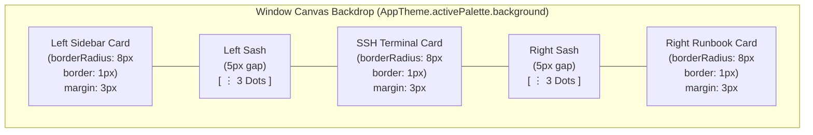
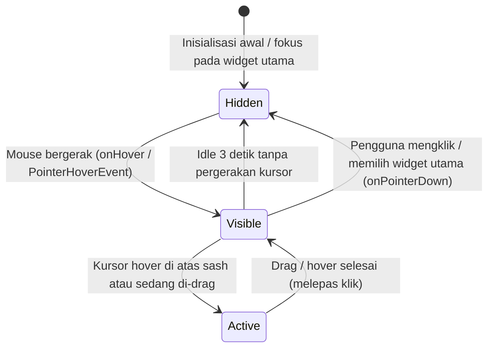

# NexusFX Modern Floating Island UI Design Specification

Dokumentasi spesifikasi desain antarmuka **Modern Floating Island / Card-Based Architecture** pada NexusFX, mengadopsi estetika VS Code modern, Arc Browser, dan Cursor IDE.

---

## 1. Filosofi & Konsep Desain

Berbeda dengan tata letak desktop klasik yang menyatukan panel secara datar dan menempel dari ujung ke ujung (*edge-to-edge*), arsitektur **Floating Island** memisahkan setiap modul fungsional ke dalam **kartu independen (*island*)** yang melayang di atas kanvas latar belakang jendela (*window canvas backdrop*).

### Keunggulan Desain:
* **Pemisahan Kontekstual yang Bersih**: Setiap modul kerja (navigasi, sesi terminal SSH, dan runbook) memiliki batas yang jelas dengan sudut membulat (*rounded corners*).
* **Fokus Bebas Distraksi**: Pembatas dan elemen pegangan *resize* hanya muncul saat dibutuhkan (saat mouse aktif) dan menghilang otomatis saat pengguna fokus mengetik atau mengklik area kerja utama.
* **Afodansi Visual Jelas**: Tiga titik vertikal (*3-dot gripper*) pada celah sempit memberi petunjuk interaksi bahwa panel dapat di-resize dengan menarik garis pembatas.

---

## 2. Diagram Arsitektur Tata Letak

---

## 3. Spesifikasi Komponen & Geometri

### A. Window Canvas (Latar Belakang Dasar)
* **Warna Latar:** `AppTheme.activePalette.background` (misalnya `#1D1E25` pada Dark Antigravity, `#121314` pada VS Code Dark).
* **Fungsi:** Menjadi kanvas dasar tempat celah pemisah dan margin luar kartu menampilkan kedalaman (*depth*).

### B. Tiga Kartu Pulau (*Floating Island Cards*)

| Komponen | Latar Belakang | Border Radius | Tebal & Warna Border | Margin Luar |
| :--- | :--- | :--- | :--- | :--- |
| **Left Sidebar Card** | `AppTheme.bgSurfaceSecondary` | `8.0 px` | `1.0 px`, `borderSubtle.withValues(alpha: 0.6)` | `EdgeInsets.only(left: 3, top: 3, bottom: 3)` |
| **Center Terminal Card** | `palette.surfaceColor` (`bgSurface`) | `8.0 px` | `1.0 px`, `inputBorderColor.withValues(alpha: 0.6)` | `EdgeInsets.only(top: 3, bottom: 3)` |
| **Right Runbook Card** | `palette.background` (`bgSurfaceSecondary`) | `8.0 px` | `1.0 px`, `inputBorderColor.withValues(alpha: 0.6)` | `EdgeInsets.only(top: 3, bottom: 3, right: 3)` |

> [!NOTE]
> Seluruh kartu wajib menggunakan `clipBehavior: Clip.antiAlias` pada widget `Material` agar seluruh elemen di dalamnya (seperti tab header *"Debian"* atau *"Files"*) terpotong presisi melengkung sesuai sudut kartu.

---

### C. Pembatas Celah (*Sash Divider*) & 3-Dot Gripper

| Parameter | Nilai Spesifikasi | Keterangan |
| :--- | :--- | :--- |
| **Lebar Celah (*Gutter Width*)** | `5.0 px` | Celah vertikal transparan di antara kedua kartu |
| **Jumlah Titik (*Dots*)** | `3` buah | Tersusun secara vertikal tepat di tengah (`Alignment.center`) |
| **Ukuran Titik** | `3.0 px × 3.0 px` | Berbentuk lingkaran sempurna (`BoxShape.circle`) |
| **Jarak Vertikal Antar Titik** | `3.0 px` | `SizedBox(height: 3)` |
| **Warna Titik Normal** | `textColor.withValues(alpha: 0.5)` | Abu-abu redup / kontras rendah |
| **Warna Titik Aktif (*Hover / Drag*)** | `palette.primaryColor` (`accentPrimary`) | Menyala terang dengan aksen aktif |
| **Garis Panduan (*Active Guide*)** | `1.0 px` vertikal | Muncul di belakang 3 dot saat pembatas disentuh / di-drag |

---

## 4. Siklus Hidup & Logika Animasi 3 Dot

### Aturan Perilaku:
1. **Mouse Bergerak (*Fade In*):**
   * Menggerakkan mouse di atas kanvas atau melintasi panel memicu `_showDotsWithAutoFade()`.
   * Ketiga dot bertransisi halus ke `opacity: 1.0` menggunakan `AnimatedOpacity` berdurasi `200ms` dengan kurva `Curves.easeInOut`.
2. **Idle 3 Detik (*Fade Out* Otomatis):**
   * Timer internal `3 detik` berjalan setiap kali kursor bergerak.
   * Jika tidak ada gerakan mouse selama 3 detik penuh, ketiga dot bertransisi halus ke `opacity: 0.0`.
3. **Memilih Widget Utama (*Fade Out* Seketika):**
   * Ketika pengguna mengklik atau mengetik di dalam area kerja utama (Terminal SSH atau Sessions list), `onPointerDown` via `Listener(behavior: HitTestBehavior.translucent)` langsung membatalkan timer dan mengubah status `_isMainWidgetSelected = true`.
   * Ketiga dot seketika menghilang (*opacity: 0.0*) agar pandangan pengguna tetap bersih.
4. **Interaksi Langsung (*Hover & Drag*):**
   * Saat kursor menyentuh area sash `5px` (`MouseRegion.onEnter` atau saat drag), status `_isMainWidgetSelected` di-reset ke `false` dan titik selalu tampil 100% dengan highlight aksen primer.
   * Fitur *double-tap / double-click* pada sash mengembalikan lebar sidebar ke ukuran standar (`defaultSidebarWidth: 170.0` untuk kiri, `440.0` untuk kanan).

---

## 5. Implementasi Berkas Codebase

Perubahan desain ini diimplementasikan secara terintegrasi pada tiga berkas utama:

1. **[`lib/screens/main_screen.dart`](file:///c:/Dev/projects/nexus_fx/lib/screens/main_screen.dart)**:
   * Mengatur latar belakang jendela (`Scaffold.backgroundColor`).
   * Mengelola kartu Left Sidebar (`_buildSidebar()`) dan pembatas kiri (`_buildResizeHandle()`).
   * Menangani kondisional pelepasan kontainer tunggal (`isNexusWithRightSidebar`) agar Terminal dan Right Sidebar dapat mekar menjadi dua kartu independen.
   * Mengelola timer auto-fade 3 detik untuk sisi kiri.

2. **[`lib/screens/nexus_screen.dart`](file:///c:/Dev/projects/nexus_fx/lib/screens/nexus_screen.dart)**:
   * Membungkus `_buildTerminalMainArea()` ke dalam kartu `Material` independen saat Right Sidebar aktif.
   * Menangkap sinyal klik pointer (`Listener`) dan gerakan kursor (`MouseRegion`) untuk menyelaraskan status tampilan 3-dot di sisi kanan.

3. **[`lib/widgets/interactive_runbook_sidebar.dart`](file:///c:/Dev/projects/nexus_fx/lib/widgets/interactive_runbook_sidebar.dart)**:
   * Membungkus konten Right Sidebar (Runbook) ke dalam kartu `Material` independen (`borderRadius: 8px`, margin: `top: 3, bottom: 3, right: 3`).
   * Mengimplementasikan sash divider kiri selebar `5px` lengkap dengan 3 dot (`3px × 3px`, jarak `3px`).
   * Mengelola timer idle 3 detik dan logika hover/drag untuk Right Sidebar.

---

## 6. Verifikasi & Pengujian Otomatis

Desain ini didukung oleh rangkaian pengujian unit otomatis di:
* **[`test/screens/main_screen_test.dart`](file:///c:/Dev/projects/nexus_fx/test/screens/main_screen_test.dart)**
* **[`test/widgets/interactive_runbook_sidebar_test.dart`](file:///c:/Dev/projects/nexus_fx/test/widgets/interactive_runbook_sidebar_test.dart)**

Pengujian mencakup:
* Fade in saat mouse bergerak.
* Fade out otomatis saat idle selama 3 detik.
* Fade out seketika saat mengklik area widget utama.
* Resize drag handle dan fungsionalitas double-tap restore.
* Pemisahan kartu tanpa regresi fungsional (seluruh 42 unit test lulus 100%).
